# Design explorations

These are the report design explorations and a step by step walkthrough of the browser extension. Every address, building, listing site and number in them is invented sample data, and the pictures are flat drawings or grey boxes.

## Direction A
A white page with large serif type, a grid of claims against the four sources, and each mismatch shown as the listing's words struck through above the measured value. This is the direction that shipped in the full report.

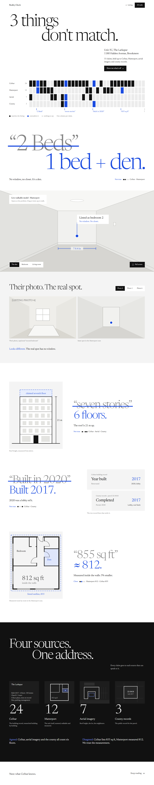 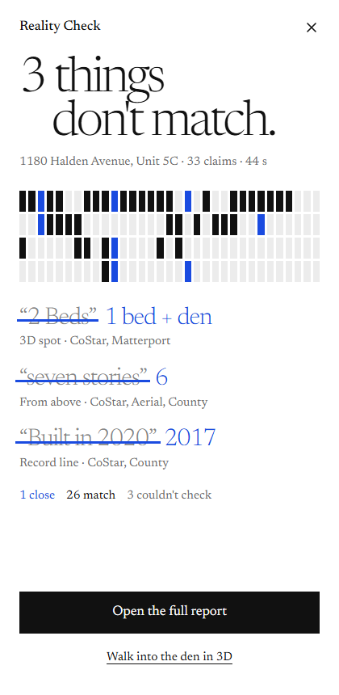 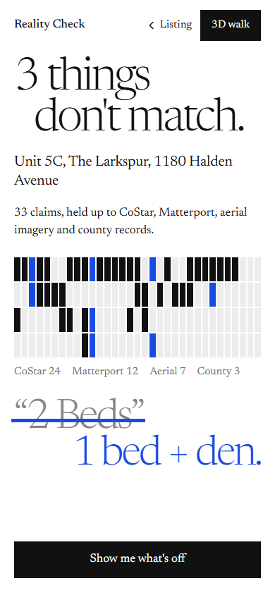

## Direction B
A dark green page in bold condensed capitals that opens on a drawn 3D room, with a coloured tally bar and a stacked building drawing for the four sources.

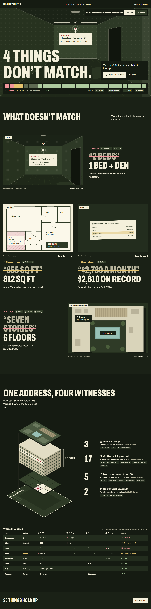 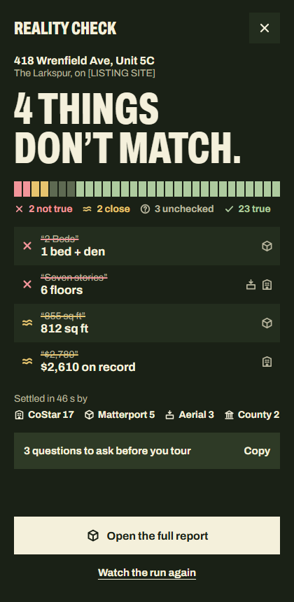 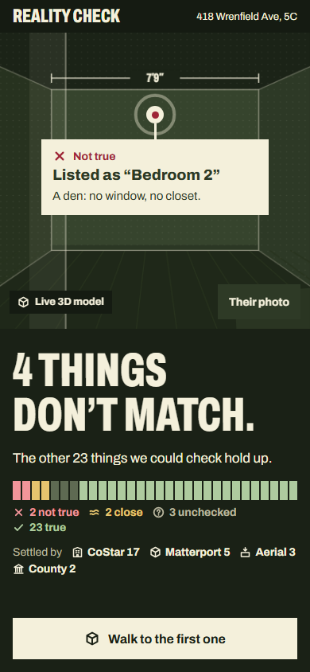

## Direction C
A bright blue and off white page in bold capitals that leads with "Mostly true", lists each finding with source chips, and ends with a table of what each source said.

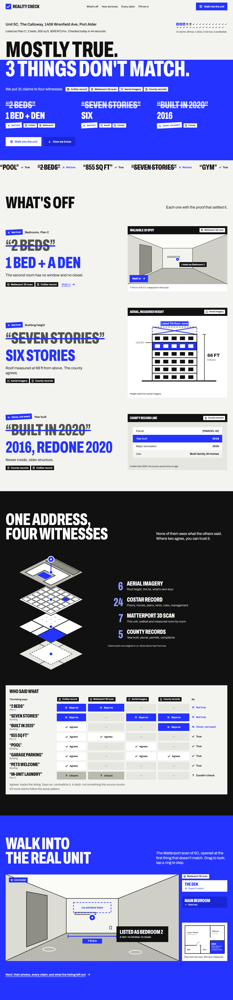 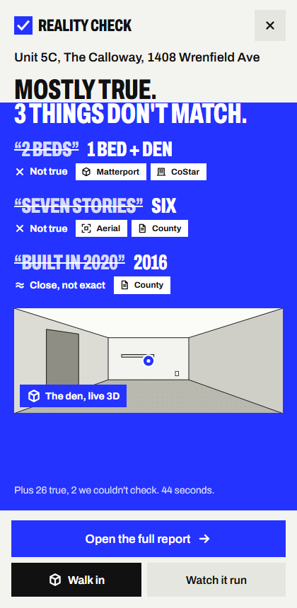 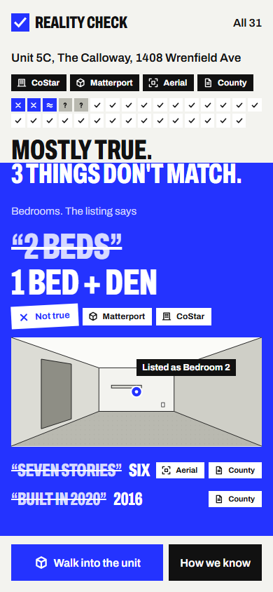

## Extension walkthrough

1. The sample listing page before any check, with the addresses underlined. 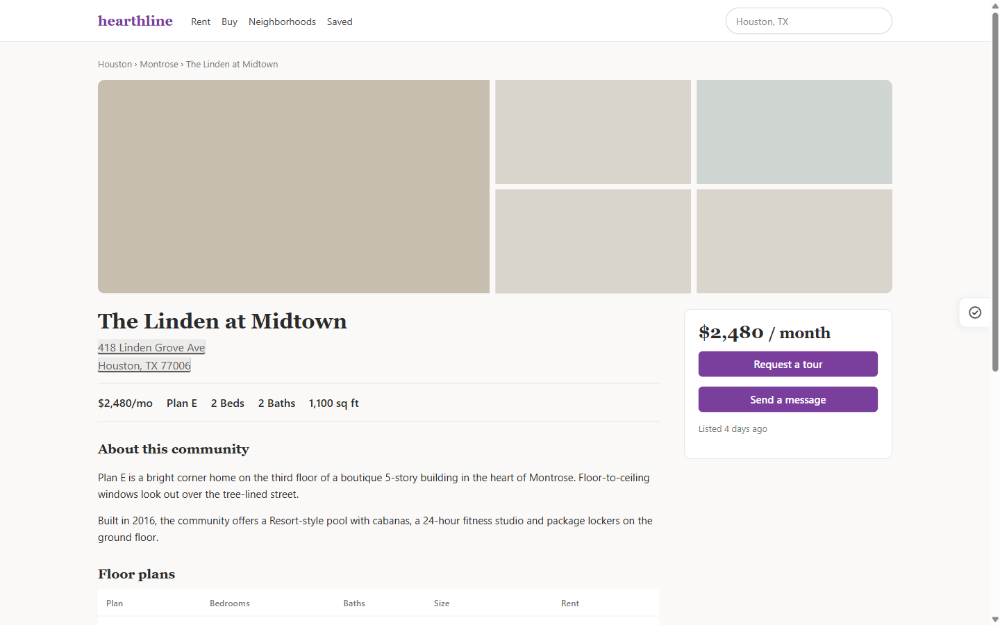
2. The drawer opens and offers the addresses found on the page. 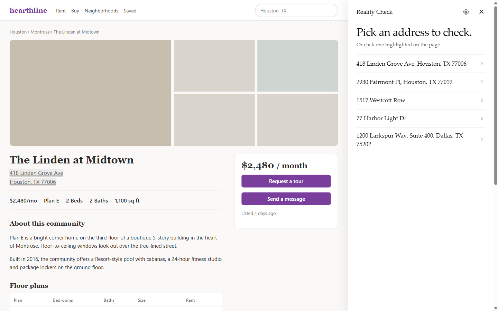
3. The check starts and the timer runs. 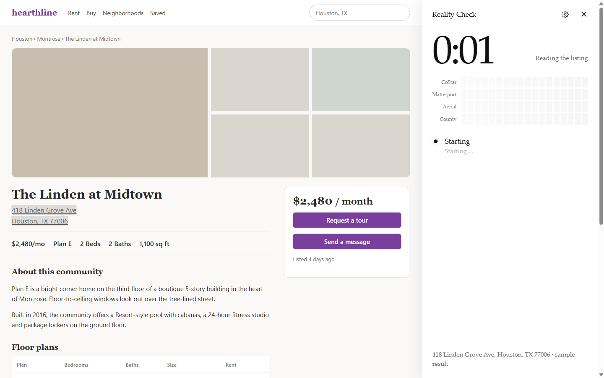
4. Claims arrive source by source and fill the grid. 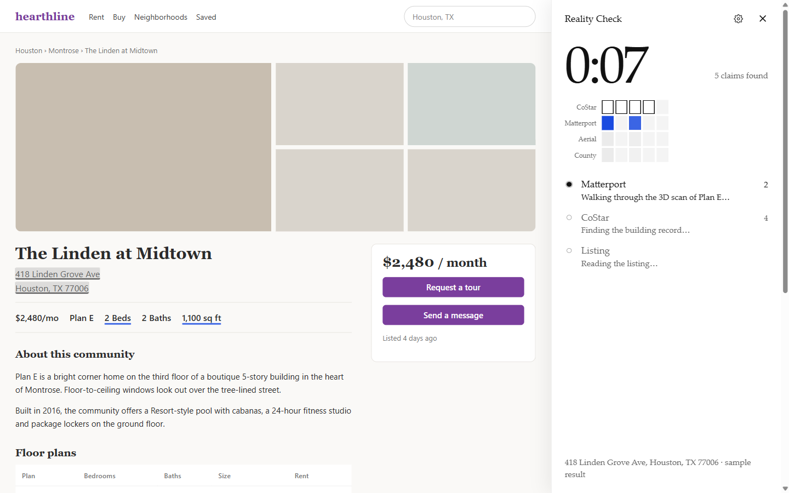
5. The finished drawer with the three mismatches. 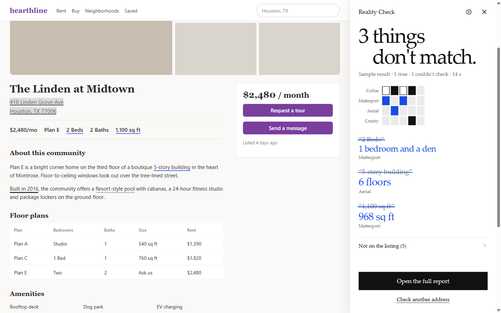
6. Facts the listing left out, opened in the drawer. 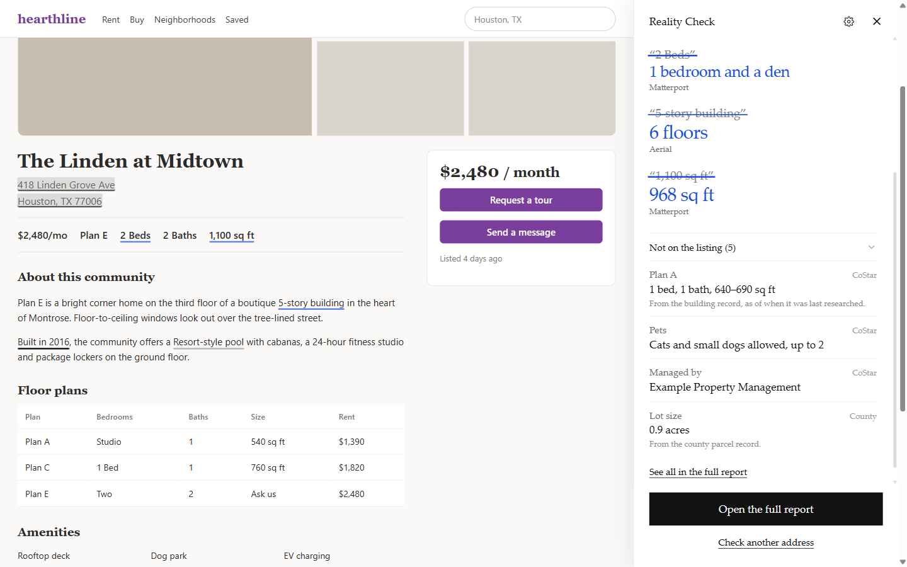
7. A mark on the page with a short note on hover. 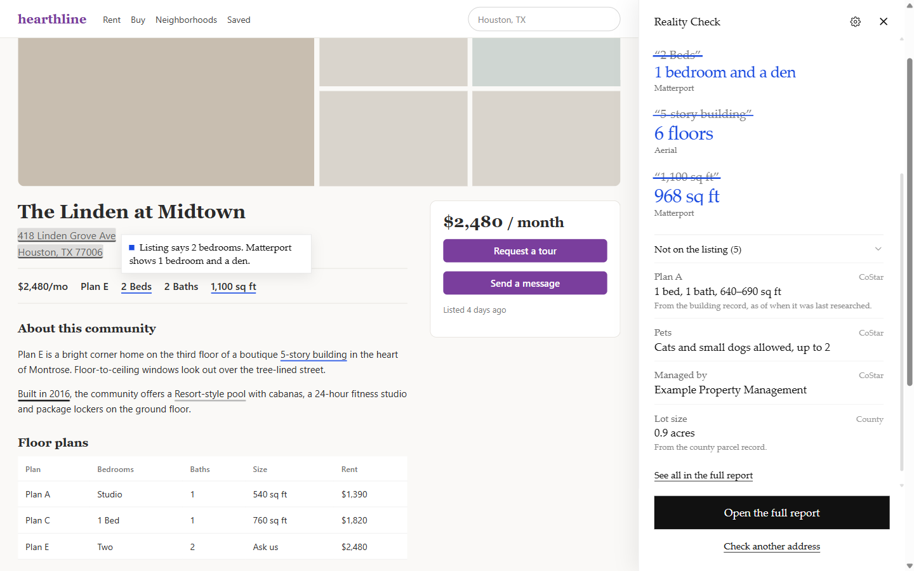
8. Marks across the rest of the page. 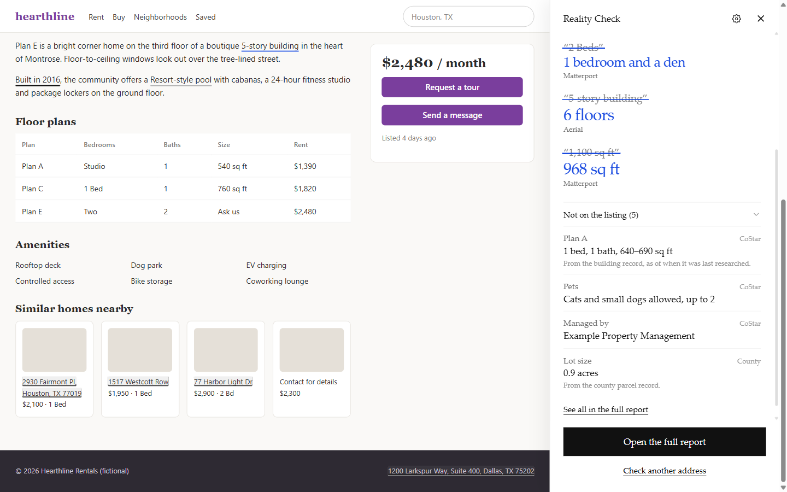
9. The full report for the sample address. 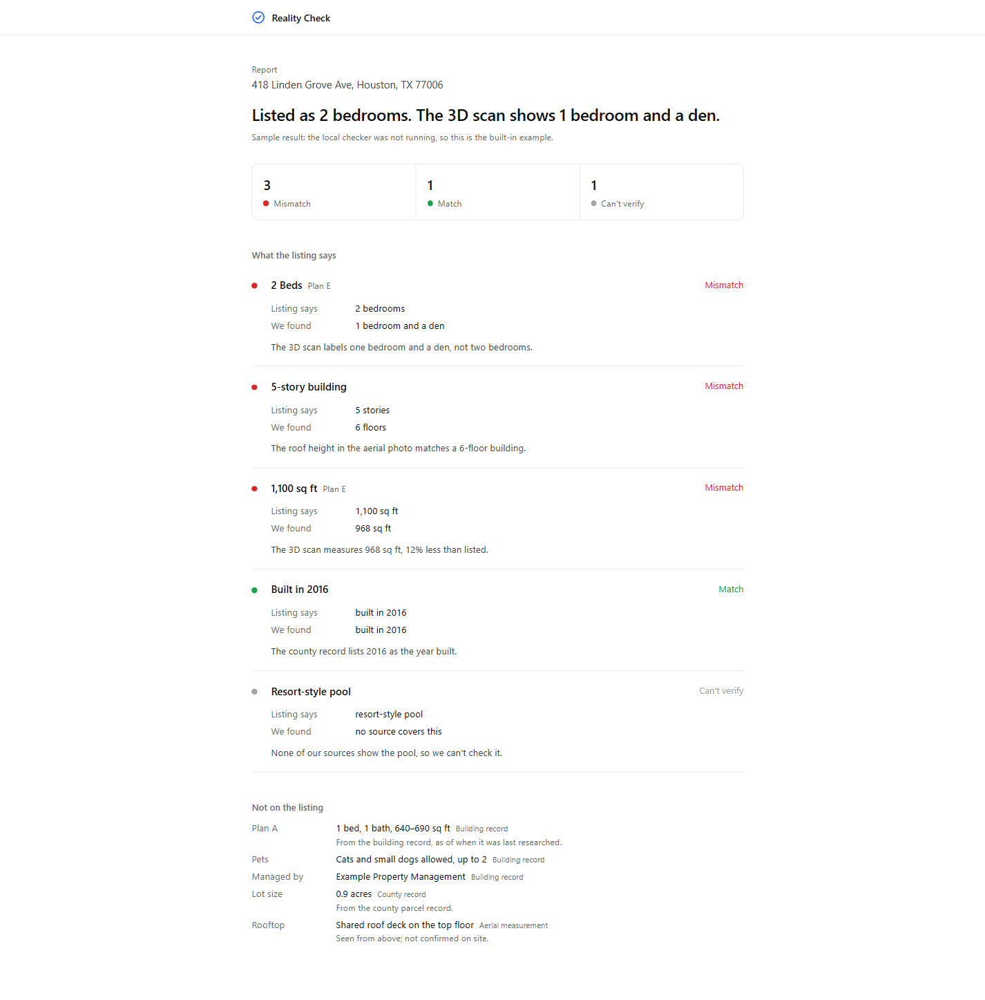

## Redesign proposal

[redesign_v2.html](redesign_v2.html) is a standalone page with the drawer states, the full report, a cut list and a field map. Open it in a browser.
